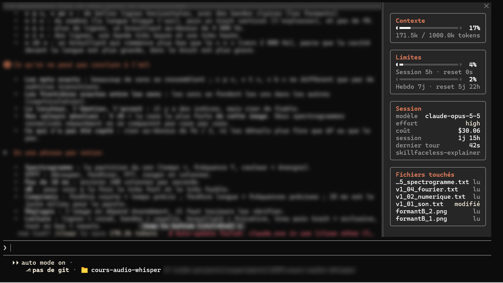

# my-mods — side-dashboard for Claude Code / configuration Claude Code reproductible



*Conversation text and folder path blurred on purpose. / Le texte de la conversation et le chemin du dossier sont floutés volontairement.*

## English

**side-dashboard** is a Claude Code mod that docks a panel on the right of the terminal, so you can see what's going on in a session without typing commands:

- **Context**: tokens used out of the context window, with a progress bar
- **Limits**: 5h session and weekly usage, with time until reset (Claude subscription only)
- **Session**: model, effort, cost, duration, last turn time
- **Touched files**: what Claude read or edited this session

It also restyles the responses (one accent colour, numbered headings in orange discs, airier spacing),
shows your sent messages in rounded cards, adds a bar under the prompt (git branch, folder, path),
and comes with a **Claude orange** theme: the dark theme without the purple.

The interface labels are in French (*Contexte*, *Limites*, *Fichiers touchés*…).
Tested with Claude Code **2.1.291** on Windows 11.

### Install

```powershell
git clone https://github.com/Davso20K/claude-code-interface-config "$HOME\.claude\my-mods"
cd "$HOME\.claude\my-mods"
powershell -ExecutionPolicy Bypass -File .\setup.ps1
```

The script adds this folder as a local plugin marketplace, installs `side-dashboard` for all sessions
and copies the theme to `~/.claude/themes/`. Restart Claude Code, then pick the theme with `/theme`.

### Requirements and known limits

- Fullscreen mode (the default on 2.1.291) and a terminal at least 110 columns wide; the panel opens on your first message.
- The `◖ ▬ ◗` bar glyphs need a font that has them (Cascadia does).
- To change the mod, edit `side-dashboard/hooks/register.tsx`, then run `/reload-plugins`.

---

## Français

Marketplace locale contenant le mod **side-dashboard** et les réglages associés.
Testé avec Claude Code **2.1.291** sous Windows 11.

### Ce que fait side-dashboard

- **Panneau de droite** (carte Contexte, Limites 5h / 7j, Session, Fichiers touchés), ouvert au premier message.
  Couleurs par clés de thème : il suit le thème de Claude Code.
- **Bandeau sous le prompt**, sans contour : branche git, dossier, chemin (via `PromptHint`).
- **Réponses mises en forme**, palette épurée (un seul accent, l'orange Claude) :
  titres en orange sans gras avec un ◆ gris ; titres numérotés (`## 5. …`) et puces numérotées qui s'ouvrent sur un **titre en gras**
  avec le numéro dans un disque plein orange ❶ ❷ … ❿ ; puces ordinaires serrées, puces à disque séparées par une ligne vide ;
  `code` en ligne en pastille sombre ; citations avec barre ; blocs Insight encadrés.
  Une ligne vide entre un titre et son contenu et quand le type de bloc change.
  Tableaux et blocs de code gardent le rendu natif, au milieu du reste.
- **Thème « Claude orange »** (`themes/claude-orange.json`) : le thème sombre sans le violet (autocomplétion `/`, fenêtres de choix, `code` des tableaux),
  avec « auto mode on » en crème. Il doit être dans `~/.claude/themes/` : `setup.ps1` l'y copie, puis `/theme` ou `"theme": "custom:claude-orange"`.
- **Tes messages envoyés** dans une carte à bords arrondis (`UserMessage`).

### Installer sur une nouvelle machine

```powershell
# 1. Copier ce dossier (ex. C:\Users\<toi>\.claude\my-mods), puis :
powershell -ExecutionPolicy Bypass -File .\setup.ps1
```

Ou à la main :

```powershell
claude plugin marketplace add C:\Users\<toi>\.claude\my-mods
claude plugin install side-dashboard@my-mods --scope user
```

Depuis un dépôt GitHub (si ce dossier y est poussé, avec `.claude-plugin/marketplace.json` à la racine) :

```
/plugin install side-dashboard --marketplace <owner>/<repo>
```

Redémarrer Claude Code ensuite. Modifier le mod : éditer
`side-dashboard\hooks\register.tsx`, puis `/reload-plugins`.

### Conditions et limites connues

- Le panneau docké à droite demande le **mode plein écran** de Claude Code (le défaut sur 2.1.291) et un terminal d'au moins 110 colonnes ;
  ouvert sans action de la personne il exigerait 144 colonnes, c'est pourquoi le mod l'ouvre au premier message envoyé.
- Les limites 5h / 7j n'existent qu'avec un abonnement Claude.
- Les glyphes `◖ ▬ ◗` de la barre dépendent de la police du terminal (Cascadia les contient).
- Pas d'en-tête fixe en haut de la conversation, ni de forme arrondie pour la zone de saisie : les mods n'y ont pas accès.

### Réglages hors mod (voir settings-snippet.json)

- `theme` : `custom:claude-orange` (voir plus haut).
- Plugins officiels activés : `code-simplifier`, `explanatory-output-style`, `data-engineering`.
- Plugin **mlflow désactivé** : son hook `UserPromptSubmit` lance un script `.py` avec `python3`,
  qui n'existe pas sous Windows (seul le raccourci du Microsoft Store répond, avec « Python was not found »).
  Pour le réactiver : `claude plugin enable mlflow@claude-plugins-official`, après avoir fourni un vrai `python3` dans le `PATH`.
